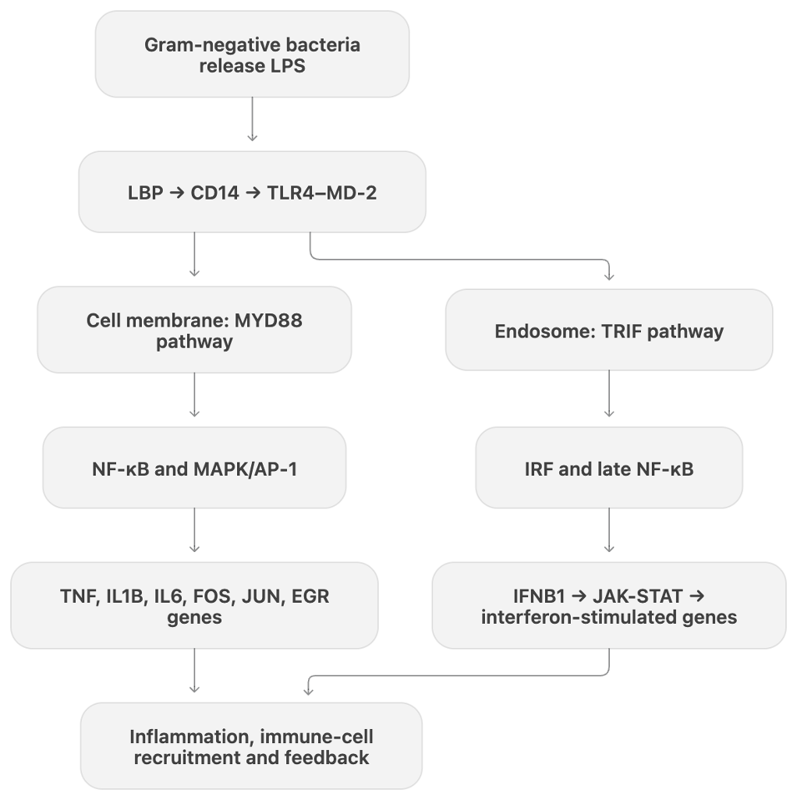
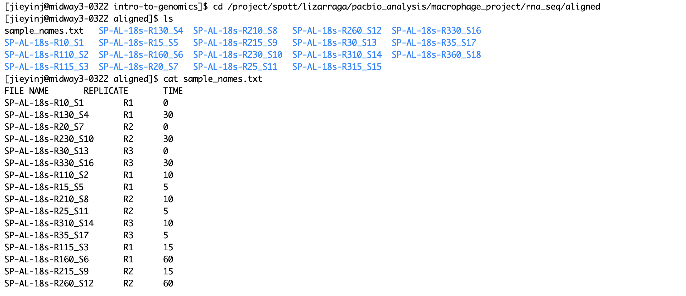

\

Macrophage + LPS (What is the expected outcome?)

1.  What is the experimental design?

2.  Research question? What do you need (data for the analysis)

3.  How would you analyze the data?

4.  ANOVA

    What is the eq in the DESeq?

    Can be found in the DESeq vignette

# Intro to Macrophage and LPS

Macrophages are innate immune cells that help detect and remove pathogens and coordinate inflammatory responses. Lipopolysaccharide (LPS) is a component of the outer membrane of Gram-negative bacteria. Recognition of LPS by the TLR4–MD-2 receptor complex initiates innate immune signaling.

## Gene Involved

+----------------------------------------------+-------------------------------------------------------+-------------------------------------------------------------------------------------------------------------------------------------------------------------------------------------------------------------------------------------------------------------------------------------------------------------+
| Biological function                          | Genes involved                                        | What this function does                                                                                                                                                                                                                                                                                     |
+----------------------------------------------+-------------------------------------------------------+-------------------------------------------------------------------------------------------------------------------------------------------------------------------------------------------------------------------------------------------------------------------------------------------------------------+
| Inflammatory cytokine response               | TNF, IL1B, IL6, IL10                                  | These genes produce signaling molecules that allow the macrophage to communicate with nearby cells.                                                                                                                                                                                                         |
|                                              |                                                       |                                                                                                                                                                                                                                                                                                             |
|                                              |                                                       | TNF, IL1B, and IL6 promote inflammation, activate endothelial and immune cells.                                                                                                                                                                                                                             |
|                                              |                                                       |                                                                                                                                                                                                                                                                                                             |
|                                              |                                                       | IL10: anti-inflammatory role                                                                                                                                                                                                                                                                                |
+----------------------------------------------+-------------------------------------------------------+-------------------------------------------------------------------------------------------------------------------------------------------------------------------------------------------------------------------------------------------------------------------------------------------------------------+
| Negative feedback response                   | DUSP1, DUSP2, NFKBIA, NFKBIB, NFKBIE, NFKBIZ, TNFAIP3 | This response limits LPS signaling after it has been activated.                                                                                                                                                                                                                                             |
|                                              |                                                       |                                                                                                                                                                                                                                                                                                             |
|                                              |                                                       | reduce prolonged inflammation                                                                                                                                                                                                                                                                               |
+----------------------------------------------+-------------------------------------------------------+-------------------------------------------------------------------------------------------------------------------------------------------------------------------------------------------------------------------------------------------------------------------------------------------------------------+
| Early interferon response                    | IRF1, IFNB1                                           | IRF1 helps start an antiviral and inflammatory transcriptional program. IFNB1 encodes interferon beta, a secreted type I interferon.                                                                                                                                                                        |
+----------------------------------------------+-------------------------------------------------------+-------------------------------------------------------------------------------------------------------------------------------------------------------------------------------------------------------------------------------------------------------------------------------------------------------------+
| Downstream interferon and chemokine response | IFIT2, IFIT3, IFIT5, CCL3, CCL4, CXCL10, SOCS1, SOCS3 | IFIT2, IFIT3, and IFIT5 are interferon-stimulated genes that help restrict viral RNA and protein production. CCL3, CCL4, and CXCL10 are chemokines that attract monocytes, T cells, and natural killer cells. SOCS1 and SOCS3 provide negative feedback by limiting JAK-STAT signaling.                     |
+----------------------------------------------+-------------------------------------------------------+-------------------------------------------------------------------------------------------------------------------------------------------------------------------------------------------------------------------------------------------------------------------------------------------------------------+
| LPS recognition and signaling                | TLR4, CD14, MYD88, TICAM1, IRAK1, TRAF6               | CD14 helps capture LPS and deliver it to the TLR4 receptor complex. TLR4 then uses adaptor proteins such as MYD88 and TICAM1 to transmit the signal. IRAK1 and TRAF6 pass the signal downstream, leading to activation of NF-kB, MAPK, and interferon-related pathways that control immune gene expression. |
+----------------------------------------------+-------------------------------------------------------+-------------------------------------------------------------------------------------------------------------------------------------------------------------------------------------------------------------------------------------------------------------------------------------------------------------+
| Macrophage identity and baseline expression  | CD68, CSF1R, LYZ, FCGR1A, C1QA, C1QB, C1QC            | These genes describe normal macrophage identity and function.                                                                                                                                                                                                                                               |
+----------------------------------------------+-------------------------------------------------------+-------------------------------------------------------------------------------------------------------------------------------------------------------------------------------------------------------------------------------------------------------------------------------------------------------------+



## Expected Outcome?

We expect some genes to change their expression after LPS treatment. For example, FOS, JUN, EGR1, and TNF may show increased expression. Some genes may respond quickly, while others may respond later. Their expression may also decrease again after an initial increase.

1.  Experimental Design:

    Human macrophages were treated with lipopolysaccharide (LPS) in a 60-minute time experiment. Untreated samples collected at 0 minutes served as control. LPS-treated samples were collected at 5, 10, 30, and 60 minutes after stimulation. There are three replicants(R1\~R3) included in the experiment. Gene expression was measured using RNA sequencing.

2.  Research question?

    Which genes are differentially expressed in human macrophages at 5, 10, 30, and 60 minutes after LPS stimulation compared with the untreated 0 minute control?

    What data needed?

    raw gene count matrix with genes as rows and RNA seq samples as columns

    sample metadata

3.  How would you analyze the data?

    Match the raw gene counts to the sample metadata and filter out lowly expressed genes. Use PCA to check how samples cluster by time point and look for outliers.

    Use DESeq2 to model gene expression with time point and 0 minutes is the reference.

    Use a likelihood ratio test (LRT) to identify genes whose expression varies across the time course. Then use Wald tests to compare 5, 10, 30, and 60 minutes individually with the untreated 0-minute control.

    log₂ fold changes and adjusted p-values for each comparison

4.  ANOVA/DESeq

    likelihood ratio test

## 

```{r}
library(tidyverse)
library(DESeq2)
library(annotables)
library(PCAtools)
library(EnhancedVolcano)
library(clusterProfiler)
library(ggrepel)
```

```{r}
# install.packages("devtools")
# devtools::install_github("stephenturner/annotables")
```

```{r}
source("/project/spott/jieyinj/intro-to-genomics/DESeq_Functions.R")
```

# Build Count Matrix

Directory of the counts: `/project/spott/lizarraga/pacbio_analysis/macrophage_project/rna_seq/aligned`




Steps:

1.  Delete the first four rows.
2.  Extract the first column. Extract the fourth column.

\*Step 1 and 2 need to be done for all samples.

3.  Compare the Gene ID of each sample with the first sample's Gene ID. If they are the same, we add the second column of each sample to the final count matrix.

```{r}
paths <- list.files(path = "/project/spott/lizarraga/pacbio_analysis/macrophage_project/rna_seq/aligned", recursive = TRUE, pattern = "ReadsPerGene.out.tab", full.names = TRUE)
paths
```

```{r}
sample_name <- gsub("/project/spott/lizarraga/pacbio_analysis/macrophage_project/rna_seq/aligned/", "", dirname(paths))
```

```{r}
count_tables <- lapply(paths, function(x) read_delim(x, skip = 4, col_names = FALSE, col_select = c(1, 4)))
class(count_tables)
print(count_tables)
names(count_tables) <- sample_name
```

```{r}
stopifnot(all(sapply(count_tables, function(x) identical(count_tables[[1]]$X1, x$X1))))
raw_counts <- sapply(count_tables, function(x) x[[2]])
rownames(raw_counts) <- count_tables[[1]]$X1
head(raw_counts)
```

```{r}
metadata_table <- read.delim("/project/spott/lizarraga/pacbio_analysis/macrophage_project/rna_seq/aligned/sample_names.txt", row.names = 1)
rownames(metadata_table)
```
